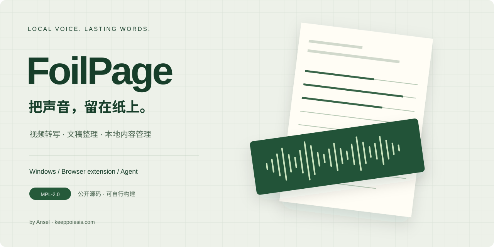

<p align="center"></p>

# FoilPage

[使用指南](docs/user-guide.md) · [产品官网](https://foilpage.early-snipe-7202.chatgpt.site) · [源码发行](https://github.com/Ansel-Poiesis/FoilPage-source/releases) · [报告问题](docs/bug-reporting.md)

视频转写、文本整理与本地内容管理。Windows 桌面应用，配套浏览器扩展和 Agent CLI / MCP。

源码版本 **0.1.0**，自有源码采用 **MPL-2.0**。

## 功能

- 本地 Whisper 语音识别，支持 CPU 与可选 NVIDIA GPU。
- 导入本地音视频，管理任务、原始转写、整理正文与字幕。
- 浏览器扩展支持抖音、B 站和 YouTube 的页面下载与转写入口。
- 使用自己的模型 API Key 整理正文、优化标题。
- 官方托管 AI 使用账户订阅与积分，可用能力以服务返回为准。
- CLI 与 MCP 支持带 revision 的文稿编辑、任务查询和应用操作。

## 获取源码

```powershell
git clone https://github.com/Ansel-Poiesis/FoilPage-source.git
cd FoilPage-source
git checkout v0.1.0
```

v0.1.0 提供源码归档。安装器与 GPU 包随各自经过验证的二进制版本发布。

## 从源码运行

环境要求为 Windows 10/11、Python 3.11、Microsoft Edge WebView2 Runtime。Node.js 22 用于开发验证。GPU 模式使用兼容的 NVIDIA 驱动与运行库。

```powershell
py -3.11 -m venv .venv
& .\.venv\Scripts\python.exe -m pip install --require-hashes -r requirements-base.lock.txt
& .\.venv\Scripts\python.exe -m pip install -r requirements-build.txt
& .\.venv\Scripts\python.exe -m app.desktop_web --data-dir .local-data
```

首次启动后按准备页完成账户登录、环境检测和模型下载。当前客户端保留官方账户验证流程。本地识别使用本机模型，BYOK 请求发送到用户配置的模型服务，官方托管 AI 按账户套餐计费。

默认资料目录为 `%LOCALAPPDATA%\FoilPage`。上述开发命令使用独立的 `.local-data`，该目录被 Git 忽略。

## 浏览器扩展

启动桌面端后，在 Chrome 或 Edge 的扩展管理页开启开发者模式，选择“加载已解压的扩展程序”，加载本仓库的 `browser-extension` 目录。在 FoilPage 浏览器连接页完成配对并刷新视频页。源码桌面端与扩展使用相同版本。

## Agent 接入

Agent 使用独立 Python 环境。

```powershell
py -3.11 -m venv .agent-venv
& .\.agent-venv\Scripts\python.exe -m pip install --require-hashes -r requirements-agent.lock.txt
& .\.agent-venv\Scripts\python.exe -m pip install -r requirements-agent-build.txt
& .\.agent-venv\Scripts\python.exe -m agent.main --data-dir .local-data info
```

完整协议与 MCP 配置见 [Agent 控制说明](docs/agent-control.md)。

## 开发验证

```powershell
npm ci
npx playwright install chromium
& .\.venv\Scripts\python.exe build/check_source.py
& .\.venv\Scripts\python.exe build/version.py --check
& .\.venv\Scripts\python.exe -m ruff check app engine agent tests
& .\.venv\Scripts\python.exe -m pytest -q
npm test
npm run test:ui
```

网络平台冒烟、模型实跑和打包程序检查由测试环境变量显式启用，测试结果列出实际跳过项。

## Windows 打包

完成上述两个 Python 环境和 Node 验证环境配置后，在 Windows 安装 Inno Setup 6，执行以下命令。

```powershell
.\build\release.ps1
```

构建脚本从干净提交生成 Desktop、Worker、Agent、扩展、安装器和 GPU 包，并收集第三方材料。产物位于 `dist` 和 `dist_installer`。分发者按 [第三方说明](THIRD_PARTY_NOTICES.md) 核对二进制的许可、对应源码和构建材料。

## 开源与订阅

本仓库发布桌面、扩展、Agent、测试和构建源码。官方托管服务由独立服务运营，其服务器实现采用单独的发布安排。源码许可权利由 MPL-2.0 规定，官方账户、模型额度和订阅服务由相应服务条款规定。

分发修改版时，按 MPL 提供受其覆盖文件的对应源码和许可声明。FoilPage 名称与标志的使用遵循 [品牌说明](TRADEMARKS.md)。

相关历史发行与托管服务的关系见[项目范围](docs/project-scope.md)。源码维护与发行的 [OSPS Level 1 核对依据](docs/security-baseline.md) 可公开复核；其范围与维护者自评性质在文中说明。

## 参与

[贡献说明](CONTRIBUTING.md) · [安全报告](SECURITY.md) · [许可全文](LICENSE) · [0.1.0 说明](docs/releases/v0.1.0.md)

作者 Ansel · [个人网站](https://keeppoiesis.com/)
